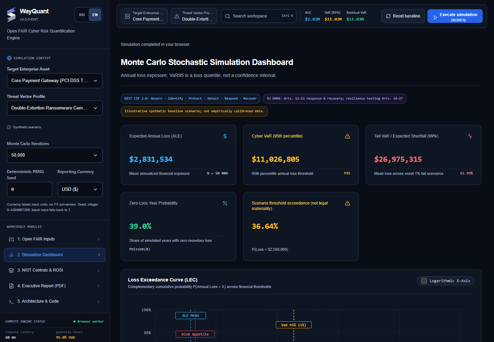
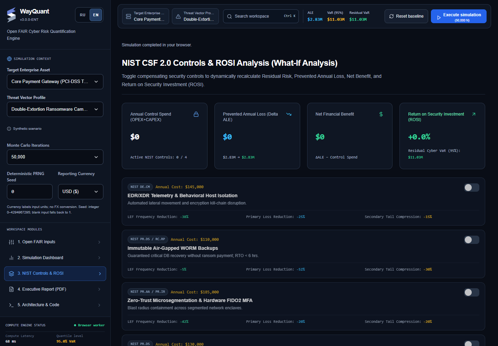
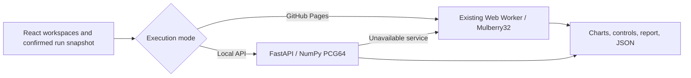

<p align="center"></p>

# WayQuant

**Free cyber risk quantification for transparent, reproducible financial risk modeling and analytical decision support.**

Version **3.0.0** · English / Русский · Apache-2.0

[Documentation](docs/DEPLOYMENT.md) · [Methodology](docs/MODEL.md) · [Installation](#run-locally) · [Audit](docs/audit/2026-11-27/FINAL_AUDIT_REPORT.md) · [Releases](https://github.com/yustem/WayQuant/releases) · [Citation](CITATION.cff)

WayQuant helps risk analysts, security leaders and researchers translate cyber scenarios into annual financial loss distributions. Select an enterprise asset and threat, calibrate frequency and severity, simulate possible years, and compare the financial effect and cost of security controls. Every exported result records its inputs, engine, seed and software version.

## Five connected workspaces

| Workspace | What you can do |
|---|---|
| Open FAIR Inputs | Calibrate loss frequency, primary and secondary severity; set risk appetite and materiality thresholds. |
| Simulation Dashboard | Inspect ALE, VaR95/99, CVaR99 (Expected Shortfall), annual loss distributions, percentiles and Loss Exceedance Curves. |
| NIST Controls & ROSI | Select scenario controls, compare baseline and residual risk, and examine annual cost, prevented loss and ROSI. |
| Executive Report | Produce a two-page executive report, print/save PDF in A4 or US Letter, and export the confirmed run as JSON. |
| Architecture & Code | Inspect the actual Python and browser computation sources bundled with the release. |

The shared toolbar provides deterministic seeds, simulation actions and bilingual global search across modules, assets, threats, controls, parameters and analytical sections. English is the first-visit default; language preference persists between sessions. Reporting currency labels monetary units; it does **not** perform foreign exchange conversion.

## Use WayQuant

1. Select an asset and threat in Simulation Context.
2. Review the calibrated inputs and adjust them to the scenario you are assessing.
3. Choose iterations and an explicit seed; execute the simulation.
4. Explore the dashboard, add controls, and compare residual risk and ROSI.
5. Export the executive report and the JSON run record.

The public browser edition uses the existing Web Worker engine. Inputs and results are processed on your device; no account or Python server is required. Static application assets are downloaded from GitHub Pages. The application adds no telemetry or external analytics. See [deployment and verification](docs/DEPLOYMENT.md).

## Interface





Screenshots show real calculations from the release browser engine.

## How the model works

Each Monte Carlo iteration represents one year. A modified Beta-PERT annual rate feeds a Poisson incident count. Each incident has primary loss and an independently triggered secondary loss; annual losses sum all incidents. Primary severity uses Beta-PERT. Secondary severity uses a shifted lognormal calibrated by floor, mode and P95. The resulting sample supplies ALE, loss quantiles, CVaR99 and exceedance probabilities.

The [model contract](docs/MODEL.md) documents formulas, parameter semantics, resource limits and assumptions. Presets and multiplicative control effectiveness are explicit scenario assumptions. Empirical predictive validation and enterprise infrastructure hardening are separate from software verification. The preserved [historical audit](docs/audit/2026-11-27/RELEASE_READINESS.md) retains its original conclusions and scope.

## Architecture and reproducibility



Both implementations preserve the documented model. Their PRNGs differ: compare exact results within the **same engine and runtime**, rather than expecting Python and browser bitwise equality. Identical requests and explicit seeds, including zero, reproduce numerical results within that environment. Keep the exported request, provenance, release and dependency versions with an analysis. Execution from any module starts a new run with the configured seed; it does not increment it.

## Run locally

Requires Python 3.11+ and Node.js 22+. On Windows, double-click **start.bat**; it invokes **start.ps1**, starts both services and opens the application. First-time dependency installation requires internet access. Both launcher files belong in the repository.

For manual setup, create and activate a Python virtual environment, then run:

```sh
python -m pip install -e ".[api,test]"
npm --prefix frontend ci
```

Start these commands in separate terminals from the repository root:

```sh
python -m uvicorn app.main:app --host 127.0.0.1 --port 8000 --limit-concurrency 8
```

```sh
npm --prefix frontend run dev -- --host 127.0.0.1
```

Open http://127.0.0.1:5173. The Vite proxy sends `/api` to the local backend. The default mode uses the API and the existing browser fallback on service unavailability. See [.env.example](.env.example) for explicit static mode, subpath and API configuration.

The Python package is also usable independently:

```python
from wayquant import OpenFairInput, FairMonteCarloEngine

inputs = OpenFairInput(lef_min=0.1, lef_mode=0.5, lef_max=2, random_seed=42001)
result = FairMonteCarloEngine(inputs).run_simulation()
print(result["ale"], result["cyber_var_95"])
```

`GET /api/v1/health` reports readiness; local `/docs` documents the API. [examples/reproduce.py](examples/reproduce.py) provides a deterministic example. [Deployment](docs/DEPLOYMENT.md) covers static and container configurations; [reporting notes](docs/REPORTING.md) explain export behavior.

## Validation

The preserved comprehensive audit records **186 passing tests**, including **91 independent mathematical tests**; the 91 are not an additional total. It includes **160 controlled statistical runs** and **160 exact before/after numerical comparisons**, with 25 findings: 24 corrected and one infrastructure item partially verified at that time. No unresolved P0/P1 defect was reproduced within that audit scope. This was AI-assisted engineering review, not external certification or human peer review.

The pre-publication local baseline passed **188 checks**: 36 Python, 61 frontend/browser and 91 independent mathematical tests. Publication adds a separate end-to-end static deployment regression. Current remote Linux CI and public-site evidence are recorded in [release verification](docs/release/3.0.0/VERIFICATION.md); historical reports are not rewritten to claim checks performed later.

```sh
python -m pytest -q
python -m pip install scipy==1.18.1
python -m pytest -q -p no:cacheprovider docs/audit/2026-11-27/scripts/test_independent_math.py
npm --prefix frontend run typecheck
npm --prefix frontend test
npm --prefix frontend run build
```

Browser tests require Playwright and the documented environment variables; plain `npm test` explicitly skips them. The [workflow](.github/workflows/ci.yml) installs and enables them, verifies the Python wheel, then tests the static bundle before Pages deployment. See the [audit reproduction guide](docs/audit/2026-11-27/README.md).

## Repository

```text
backend/                 Python engine, public package and FastAPI
frontend/                React UI, browser engine, worker and regression tests
tests/                   Python/API regression tests
docs/MODEL.md            Scientific model contract
docs/audit/2026-11-27/    Preserved reports, reference tests and material evidence
docs/release/3.0.0/       Publication integrity and deployment verification
docs/images/             Real application screenshots
examples/                Reproducible Python example
.github/workflows/       Verification and free Pages deployment
```

## License, contribution and citation

Copyright 2026 **Yustem**. Licensed under [Apache-2.0](LICENSE); see [NOTICE](NOTICE), [third-party notices](THIRD_PARTY_NOTICES.txt), [contribution guidelines](CONTRIBUTING.md) and [security guidance](SECURITY.md).

Cite **Yustem. WayQuant (version 3.0.0).** Include the repository or release URL and the engine used. [CITATION.cff](CITATION.cff) and [.zenodo.json](.zenodo.json) prepare the release for later archival integration. No DOI has been assigned and no Zenodo deposit is claimed.
