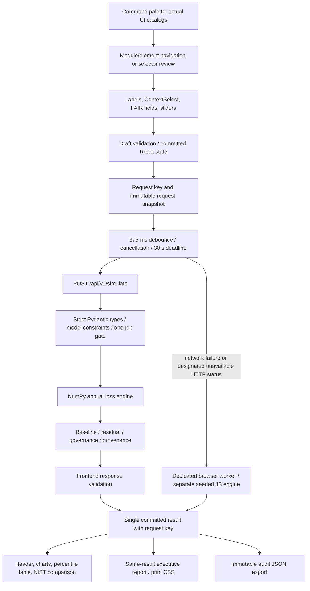

# WayQuant final independent audit

Audit date: 27 November 2026, Europe/Moscow. Baseline capture: 26 November 2026 22:46:51 UTC. Product/model version: 3.0.0. Scope: this local snapshot and the explicitly documented experiments, not an external certification or an assessment of a live enterprise deployment.

## Release recommendation: NO-GO for public production

The tested implementation is substantially more reliable after remediation. No unresolved P0/P1 implementation defect was reproduced in the final suite. Public production approval is withheld because deployment, remote CI, full accessibility/localization and empirical model validation remain incomplete. A working local research application is not evidence of a hardened public service or predictive accuracy. Exact release gates are in [RELEASE_READINESS.md](RELEASE_READINESS.md).

There are **25 confirmed findings: P0 0, P1 3, P2 20, P3 2**. **24 are FIXED; 1 remains PARTIAL** (WQ-024: the browser CI configuration has been corrected, but the actual GitHub/Linux job cannot be executed from a snapshot with no Git repository). The [final registry](FINDINGS.md) and [machine-readable registry](findings.json) identify locations, root causes, reproductions, impacts, corrections and before/after evidence. Verification gaps listed below are not hidden inside a count of corrected defects.

## Evidence and result accounting

The authoritative counters are [final-summary.json](evidence/final-summary.json). The final regression suite has **186 tests: 186 passed, 0 failed, 0 skipped**: 36 repository Python tests, 91 independent mathematical tests, and 59 frontend/worker/browser tests. Type checking, production build and pip consistency checks pass. Lint is **NOT VERIFIED**: no lint script or configuration exists. One Starlette TestClient/httpx deprecation warning remains; it is recorded rather than treated as an application runtime failure.

Separate experiments, not additional unit-test counts: 146 API validation cases; 160 controlled statistical runs (80 per engine); 160 exact before/after valid-output comparisons (80 per engine); two isolated mutation experiments; 60 module/language/resolution checks; 10 axe scans; 12 consecutive real worker runs; four real JSON/PDF report pairs, eight rendered PDF pages. Counts from repeated exploratory runs are not added to the final test total.

| Area | Status | Supporting evidence and scope |
|---|---|---|
| Mathematical implementation | PASS | Independent identities, aggregation, calibration, estimators and boundary tests; [mathematical report](MATHEMATICAL_VALIDATION.md) |
| Statistical implementation | PASS | Fixed-seed distribution/moment checks and controlled convergence experiments within supported limits; not a universal RNG certification |
| Empirical predictive validity | NOT VERIFIED | No observed incident/loss/control-outcome dataset supplied |
| UI/UX | PARTIAL | Five modules, two languages, six viewports pass tested geometry/interactions; full RU report translation and assistive-technology assessment remain incomplete |
| Security | PARTIAL | Local boundary, CORS, dependency and bounded-resource checks pass; no public deployment penetration test/container execution |
| Reliability | PARTIAL | Injected API/worker failures, timeout, stale results and duplicate-click recovery pass; prolonged use and OS-level failures remain untested |
| Export | PASS | Four actual two-page PDFs, JSON provenance, print geometry and visual review; browser-native print-dialog/device variations remain outside scope |
| Performance | PARTIAL | Real timings, CPU and memory observations recorded; no sustained load/SLA or production hardware claim |
| Production build | PASS | `tsc && vite build`, built worker execution, wheel/sdist build and isolated wheel import |
| Remote CI / Docker | NOT VERIFIED | No Git checkout/remote or Docker runtime available for their actual execution |

## Baseline and architecture

The checkpoint preserved 74 source/configuration files and their hashes before remediation, without resetting or deleting user files. See [baseline environment](evidence/baseline-environment.json), [baseline manifest](evidence/baseline-manifest.json), [final source manifest](evidence/final-source-manifest.json) and [source changes](evidence/source-changes.json). There is **no `.git` directory**: branch, commit and Git diff are unavailable, not inferred. Existing `.verification-*` backups were retained. Before screenshots were rendered later from the preserved source on an isolated port, not reconstructed from the modified app.

Actual sources of truth: `frontend/src/App.tsx` owns committed state, presets, translations, the computation effect and reporting; `ContextSelect.tsx` preserves existing selection handlers; `searchIndex.ts` builds actual navigation entries; `searchNavigation.ts` focuses/scrolls real targets. `backend/app/main.py` owns active API schemas and orchestration; `backend/app/schemas/fair_models.py` only re-exports those schemas. `backend/app/engine/fair_monte_carlo.py` is the Python model, re-exported by `backend/wayquant/__init__.py`. `frontend/src/engine.js` is a separate implementation executed through `simulation.worker.js` and `workerClient.ts`. Architecture code panels import actual source text at build time. NumPy/Python math, not SciPy, is the production scientific dependency; SciPy is an independent audit oracle.

There are intentionally two PRNG/sampling implementations, two histogram grids (40 API bins / 42 browser bins), and two default LEC grids (80 API / 76 browser points). Their mathematical definitions agree where tested; identical seeds do not promise equal cross-engine samples. Maintaining both implementations remains a drift risk. Residual/baseline LECs share monetary thresholds within each run. No database, external persistence, FX service, authentication service or optimization solver was found in the active pipeline. NIST “optimization” is manual what-if selection, not an automated optimizer.

## Intentional execution correction

At the baseline, Execute outside the dashboard only navigated, and dashboard execution added 137 to the seed. The user explicitly authorized changing that behavior. The single toolbar action now executes from **all five modules**, navigates to the dashboard, uses configured inputs/iterations/**the selected seed unchanged**, shows loading, and prevents duplicate concurrent clicks. Explicit seed zero is preserved; the prior blank-field fallback to one is now disclosed. Auto-recalculation on committed edits remains in place. Tests compare complete numeric result snapshots across all five launch locations, excluding elapsed time and run metadata.

This is an intentional behavior correction, not a claim that navigation-only execution was a numerical-model bug. Separately, strict API typing now rejects numeric strings/booleans that were previously coerced. API consumers must send canonical JSON numbers/booleans.

## Scientific changes and integrity limits

No distribution, estimator, PRNG, control coefficient, scientific default or sampling formula was redefined. Engine edits are confined to independently reproduced invalid-threshold validation failures; the browser's existing positive-Infinity sentinel remains supported for its optional threshold query. All 80 valid scenarios per engine match the preserved pre-audit engine **exactly**, excluding execution time. There is no unexpected valid numerical change in that comparison domain.

Displayed analytical metrics trace to a valid result or are explicitly marked previous. Network fallback runs a real worker and is disclosed; malformed/API computation failures do not silently become success. Schematic distribution illustrations are now named as illustrations. Progress is an indeterminate busy state, not a fabricated completed-iteration percentage.

Synthetic presets and independent multiplicative control effects are assumptions, not empirical evidence. Marginal component quantiles are nonadditive. Currency selects input/reporting units without FX conversion. VaR describes a predictive loss quantile, not a confidence interval on an estimator. Rank-tail ES99 is sensitive to sample size and ties. DORA/NIST references are context, not legal advice or certification; a complete Open FAIR conformance assessment was not possible. See the [mathematical limitations](MATHEMATICAL_VALIDATION.md).

## Deliverables and reproducibility

Read [TEST_MATRIX.md](TEST_MATRIX.md), [SECURITY_AND_RELIABILITY_REPORT.md](SECURITY_AND_RELIABILITY_REPORT.md), [UI_UX_AUDIT.md](UI_UX_AUDIT.md), [PERFORMANCE_REPORT.md](PERFORMANCE_REPORT.md) and [RELEASE_READINESS.md](RELEASE_READINESS.md). [README.md](README.md) contains executable reproduction commands and distinguishes local tooling from production dependencies. Raw failures and harness corrections are retained; test assertions were not removed to obtain a favorable verdict.

## Requested phase coverage

| Phase | Status | Evidence / remaining boundary |
|---|---|---|
| 01 Baseline | PASS | Preserved manifest/checkpoint, original tests/build and actual baseline screenshots; Git identity explicitly unavailable |
| 02 Mathematics | PASS | 91 independent reference tests and formula-by-formula mathematical report |
| 03 Monte Carlo | PASS | Two-engine 160-run fixed-seed experiment, exact sample accounting and documented tail uncertainty; not universal RNG certification |
| 04 Honesty/provenance | FIXED | Result trust boundary, previous-result labels, schematic disclosure and truthful actual-engine status; frontend regressions |
| 05 Controls/ROSI | PARTIAL | Implemented multiplicative formulas independently tested; empirical coefficients, overlap and causal independence unverified |
| 06 Validation | PASS | 146 API cases plus UI/engine boundary regressions, with JSON/catalog scope documented |
| 07 Failure resilience | PARTIAL | Named injected failure/recovery cases pass; prolonged use, OS kills and actual export interruption remain unverified |
| 08 Architecture/API | PARTIAL | Active paths traced, strict API/provenance/gate tests; actual container deployment not run |
| 09 Frontend functions | PARTIAL | Five-module/browser interactions pass; all real-world browser/locale/lifecycle permutations not covered |
| 10 UI/accessibility | PARTIAL | 60 responsive checks and zero violations in 10 axe scans; real zoom/screen readers/full translation incomplete |
| 11 Global search | PASS | Real index targets, shortcuts, focus, navigation and explicit selector-confirmation tests in both languages |
| 12 Charts | FIXED | Independent bin/quantile/exceedance tests; keyboard readouts, units, log-floor and huge-domain corrections |
| 13 Export | PASS | Four actual report pairs, eight individually viewed pages and print-box measurements within stated template scope |
| 14 Security | PARTIAL | Scoped local input/CORS/advisory/signature checks; public ingress/container/security assessment unverified |
| 15 Performance | PARTIAL | Measured CPU/wall/RSS/browser/API/assets; sustained load and latency profiling incomplete |
| 16 Scientific credibility | PARTIAL | Assumptions/identities/results separated; empirical accuracy and official conformance not verified |
| 17 Test expansion | PASS | Independent references, negative cases, before-fix evidence and two isolated detected mutants |
| 18 Remediation | PARTIAL | 24 corrected/retested findings; remote CI verification remains WQ-024 |
| 19 Final regression | PASS | All final enabled tests/typecheck/build/package pass; explicit nonlocal verification gaps retained |
| 20 Deliverables | PASS | Seven reports, final registry, executable scripts, raw evidence and NO-GO release verdict |
